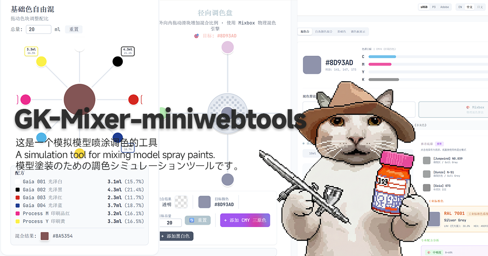

# GK Paint Mixer (GK 模玩涂装与混色工作台 · Web & App Store Edition)

[](./LICENSE)
[](https://gk-colormixer.com.hdinever.top/)
[](https://gk-colormixer.com.hdinever.top/)

> **跨平台模型模拟上色、3D 节点光影预览、物理颜料混色与涂装工程管理工具**  
> **Web 在线工作台 + iOS App Store（🇯🇵 日区 / 🇺🇸 美区 / 🇭🇰 港区已上线）**  
> *A Cross-Platform Miniature & Garage Kit Painting Studio, 3D Volumetric Shader Previewer, and Pigment Mixing Workbench.*



🔗 **Web 在线体验 (Live Studio)**: [gk-colormixer.com.hdinever.top](https://gk-colormixer.com.hdinever.top/)  
📱 **iOS / iPadOS 原生版**: 已上架 Apple App Store（日本 / 美国 / 中国香港区）

---

## ⚠️ 开源许可证与核心算法保护声明 (License & Core Protection Notice)

> **1. 许可证条款（[PolyForm Noncommercial License 1.0.0](./LICENSE)）**  
> 本仓库采用 **[PolyForm Noncommercial License 1.0.0](./LICENSE)** 开放。允许个人涂装爱好者、非营利组织与学术研究进行个人学习、实验、非商业修改与分享；**明确禁止任何未经书面授权的商业用途**（包括但不限于商业竞品抄袭移植、付费 SaaS/App 分发、品牌商业集成）。
>
> **2. 核心算法加密与知识产权保护（Encrypted Core Engine）**  
> 本项目中的核心调色与图形算法模块（包括 `mixbox.ts` 物理颜料潜空间引擎、`colorUtils.ts` 逆向比例求解器、`brandTintRecipe.ts` 品牌漆微调配方求解、`ciede2000.ts` 色差矩阵及 `coloringEngine.ts` 四层体积光影推导管线）在公开仓库中以**本地流密码加密载荷（Encrypted Runtime Payload）**形式交付，支持前端离线零延迟运行，但不公开明文算法逻辑。如需商业授权或品牌定制合作，请联系版权方获取书面许可。

---

## 🌟 产品全景介绍 (Web 版与多端核心能力)

**GK Paint Mixer v2.5** 面向机甲模玩、GK 树脂白模与微缩战棋涂装玩家，打通了从**「参考图取色 ➔ 物理调漆配比 ➔ 2D/3D 实时试色与战损预览 ➔ 涂装工序编排 ➔ 跨端二维码/工程包分享」**的完整工作流。

### 1. 🎨 模拟试色台 (`[STUDIO_CANVAS]`：2D 智能分件上色 + 3D 几何光影节点工作台)

#### 1.1 2D 线稿与实拍分件试色沙盒
- **多源底图支持**：支持直接上传黑白线稿、彩色设定官图或灰模实拍照片，也可从取色画布或涂装库一键送入。
- **智能闭合填色与选区工具**：提供智能魔棒选区、边缘闭合填色、手动补线/擦线与橡皮擦微调，精准分离外甲分件。
- **四层体积光影推导**：自动根据原图明暗梯度保留高光、主色、暗部与深暗渗线四层光影体积感，换色不丢立体细节。
- **备选与已上色漆号联动**：画布下方/侧栏实时记录已涂品牌色号，支持一键吸色、替换同色系不同品牌油漆及原图长按对比。

#### 1.2 3D 参数化装甲与 Blender 光影涂装节点工作台 (`ShoulderPad3DStudio`)
- **参数化 CSG 3D 几何生成与外部模型导入**：
  - 内置无版权风险的**原创参数化重装肩甲数学建模引擎（OpenSCAD CSG 1:1 解析求解）**，支持实时调节左右总宽、前后总深、上下总高、穹顶占比、下部外扩钟形系数、浮雕金框厚度及底口倾角。
  - 支持直接导出标准二进制 `.STL` 供 3D 打印切片，或导入外部自定义 `.STL` / `.GLB` 3D 零件模型进行涂装预览。
- **Blender 风格 5 阶体积光影 ColorRamp 节点（Shader-to-RGB）**：
  - 将**法线天顶受光（Normal · Light）+ 环境光遮蔽凹槽（AO）+ 棱边曲率（Curvature）+ 3D 空间多频点拍笔触（Stipple）**实时映射至 3 阶或 5 阶色带（`-25%L 深暗` ➔ `-13%L 微暗` ➔ `0%L 主色` ➔ `+16%L 提亮` ➔ `+31%L 极亮`）。
  - 内置 **5 种涂装过渡风格**：`盒照描边`、`手涂肌理`、`战棋分层`、`喷笔柔边`、`NMM 非金属伪金属`，配合 `消光 Matte` / `半光 Satin` / `光油 Gloss` 清漆层实时切换。
  - **🎯 喷涂分布区域向导**：新手可一键开启等高分界线模式，在 3D 表面直观查看“哪里喷暗部、哪里喷主色、哪些棱角提亮高光”。
- **6 大独立可控精细涂装与物理战损图层（含密度/尺寸/随机种子子控件）**：
  1. `📐 边缘高光描线`：沿折角与边框内缘自动勾勒双层刀锋棱边高光。
  2. `⚪ 曲面白点高光`：在穹顶受光焦点生成聚光白化原点，支持无级调节高光白点聚散尺寸。
  3. `🛢️ 做旧与污渍`：在凹槽与裙边底部自动沉积旧化渍洗污垢，支持调节污渍覆盖密度与浓淡。
  4. `🔩 金属裸露磕碰`：在高频受撞击棱角生成双层海绵掉漆（暗褐底漆黑边 + 寒铁金属裸露内芯），支持调节掉漆密度与斑块大小。
  5. `🗡️ 利刃流弹划痕`：生成稀疏锐利的银白金属划痕与暗色立体伴行阴影。
  6. `💥 3D 物理弹坑凹陷与翻起漆唇`：直接在 3D 网格顶点上雕刻真实的爆矢弹坑与链锯劈砍凹槽并重算法线，同步套用**外圈翻起高光漆唇 ➔ 中圈深灰底漆坡面 ➔ 坑底寒铁裸露与中心灼烧黑核**的多层体积涂装。
- **全端自适应交互优化**：
  - **桌面端横屏**：支持左右双列停靠及自由拖拽、缩放的不透明独立节点窗口。
  - **移动端竖屏**：4 个节点折叠菜单自动收纳至 `📌 备选与已上色漆号` 下方，画布 100% 无遮挡；配备专属 **3D 触屏操控栏**（`− 100% +`、`🎯 复位`、`🔄 单指:旋转 / ✥ 单指:平移` 一键切换、`斜视/正视/侧视/顶视` 快速方位及双击画布复位）。

---

### 2. 🏷️ 选漆与微调 (Paint Selection & Tonal Micro-Tuning)

- **品牌油漆直涂 vs. 明度色板调色**：支持直接从多品牌现成色库选漆上色，或通过色相/明度/彩度矩阵自由定制目标色。
- **期望明暗变化阶梯**：围绕当前主色自动推导 3 阶 / 5 阶冷暖自然偏色（暗部偏冷紫、高光偏暖白）的高光与阴影色阶，并自动匹配各品牌最接近的现成油漆。
- **双品牌漆物理混色试验台（Dual-Brand Trial Mixer）**：任选两款品牌油漆按比例拖动试混，实时预览物理减色混合色带（0%–100%），并一键反查最接近的现成单瓶色号。

---

### 3. 🧪 混色工作台 (Pigment Mixing Workbench)

- **广色域源图取色**：支持拖拽或粘贴图片自动提取主色调，配备高倍像素放大镜（Loupe），原生支持 **sRGB、Display P3 与 Adobe RGB (1998)** 色彩空间及超色域预警。
- **物理颜料减色混色引擎**：基于 Kubelka-Munk 光学颜料模型（蓝 + 黄 = 绿，而非 RGB 灰），提供**实色 8 色反演配方**与**纯净 CMY 减色配方**双模式。
- **虚拟调漆瓶与毫升/滴数换算**：支持 10ml–60ml 目标容量预设，实时动态计算底漆与各色源的毫升数（mL）与滴数比例，并给出智能水补土底漆（白底/灰底/黑底/粉底）建议。

---

### 4. 🗂️ 涂装库与色卡 (Project Library & Dual-Channel Sharing)

- **快捷指令式（Shortcuts-Style）涂装工序流**：
  - 涵盖 **`🛠️ 基础打底`**、**`💨 主色喷涂`**、**`✨ 进阶光影`**、**`🛡️ 封层保护`** 与 **`🖌️ 微缩手涂`** 五大标准工序分类。
  - 支持点按胶囊免打字切换喷笔口径/画笔型号、稀释比（如 `1:2.0`、`1:4.0 Glaze`、`1:0.3 湿盘`）、气压（`bar/psi`）与技法备注，并提供一键套用成套流派模板。
- **工业说明书级分享海报 & `.gkmix` 跨端工程包**：
  - 一键生成带 **90° CAD 折线部位标注、所用油漆色号清单、涂装工序流与高容错二维码**的高清分享海报。
  - 支持导出 `.gkmix` 专属工程文件或直接扫码，在 Web 端与 iOS App Store 原生端之间**免服务器无损还原**完整可编辑涂装工程。

---

### 5. 🗄️ 多品牌油漆数据库 (Multi-Brand Paint Catalog)

- 收录主流模玩与微缩涂装品牌色卡：**Gaia（盖亚）、Mr. Hobby（郡士）、Jumpwind（匠域）、Night Works（夜之工坊）、Hobby Mio（喵匠）、Sunin7（星影）、Citadel、Vallejo（AV 水性漆）、Scale75、The Army Painter** 及 **RAL Classic 工业标准色卡**。
- 支持多词空格分词检索（如品牌 + 编号 + 颜色名）、光泽/金属/透明特性过滤、双视图切换及一键加入备选试色栏。

---

## ⚡ 快速开始 (Quick Start)

```bash
# 1. 安装依赖
npm install

# 2. 启动本地开发服务器
npm run dev

# 3. 构建生产环境产物
npm run build

# 4. 本地预览生产构建
npm run preview
```

---

## ⚖️ 知识产权、第三方组件与合规声明 (IP & Compliance)

1. **非商业许可证约束（PolyForm Noncommercial 1.0.0）**：
   - 本仓库全部源码、加密核心模块与配置数据均受 **[PolyForm Noncommercial License 1.0.0](./LICENSE)** 约束，严禁任何未经授权的商业使用或商业产品集成。
2. **第三方开源组件致谢**：
   - **React / Vite / Tailwind CSS / Three.js / Phosphor Icons / Vaul**：遵循 **MIT License**。
   - **Mixbox 2.0** (Secret Weapons, Šárka Sochorová & Ondřej Jamriska)：遵循 Creative Commons Attribution-NonCommercial 4.0 International (CC BY-NC 4.0)。
3. **第三方品牌商标与原创 3D 资产免责声明**：
   - 应用内提及之油漆品牌名称、系列名称及色号仅用于客观色彩检索、色差对比与涂装工艺记录，所有商标与品牌标识均归其各自合法权利人所有，与本项目无隶属、赞助或官方背书关系。
   - 内置 3D 装甲预览模型均由参数化数学方程（CSG）实时生成，不内置任何受第三方版权保护的商业模型网格资产。

---

## 📄 许可证 (License)

本项目基于 **[PolyForm Noncommercial License 1.0.0](./LICENSE)** 授权发布。  
`Required Notice: Copyright (c) 2025-2026 HDINEVER / HDIN Studio (GK Paint Mixer — https://gk-colormixer.com.hdinever.top/)`
